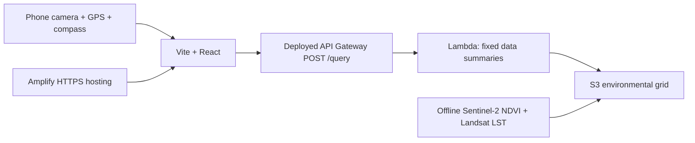

# GreenLens

Source uploads do not deploy AWS or enable automatic builds. Review [running costs and safe cleanup](docs/costs.md) before leaving the public demo running or deploying your own copy. The satellite processing guard is not an account-wide spending cap.

Website polish and security review are deployed: larger touch controls, a clearer preview label, dated surface-heat legend, compact field tools, and Escape/focus handling. Amplify now enforces a Content Security Policy and revalidates HTML. See the [security review and remaining findings](docs/security-review-2026-10-11.md).

The **Air temperature** tab now shows current 2 m air-temperature estimates from [Open-Meteo](https://open-meteo.com/en/docs), with the weather timestamp and attribution. GPS uses rounded area coordinates; the Aliganj preview uses its reference area. Weather refreshes every 15 minutes and becomes unavailable on errors or expiry, with no satellite fallback. Satellite surface heat remains separately labelled in the map and historical summaries. The free weather endpoint is for this non-commercial hackathon demo; no API key or subscription is configured.

GPS measurements now use an asynchronous Sentinel-2 NDVI and Landsat surface-temperature worker. The phone starts one cached neighborhood job, shows NDVI as soon as it is available, and keeps acquisition dates separate for each layer. Clouds and invalid samples stay empty. AWS processing checks monthly billing and conservatively reserves $1 per new generation, with a $1 margin, against the user's $10 ceiling. See the [processing plan](docs/superpowers/plans/2026-10-11-gps-satellite-processing.md).

Mobile web AR for residents, RWAs and ward officers. Three-day environment hackathon build for Sector New E, Aliganj, Lucknow. All 100 cells have real NDVI and surface-temperature observations from April 6–7, 2025, read from AWS Open Data S3 and uploaded to our private S3 bucket. The frontend uses the matching local snapshot. **The demo uses fixed data summaries instead of AI**, following the team's decision to skip Bedrock. The SAM API reads S3 and reports local conditions, nearby comparisons and planting survey candidates with measured sources. See the [backend setup and test guide](docs/backend.md).

**Live HTTPS demo:** [Open GreenLens](https://production.d3piecnpvqjn3g.amplifyapp.com). Amplify hosts the frontend and the deployed SAM API serves measured summaries. Camera, GPS and compass still require real-phone acceptance testing. See the [Amplify deployment guide](docs/amplify-hosting.md).

## Run

Use Node.js 22.12+ and npm.

```sh
npm.cmd install
npm.cmd run dev
npm.cmd test
npm.cmd run build
```

Open http://localhost:5173 on the development computer. Localhost allows camera access; a phone opening the computer's plain HTTP LAN address does not. For phone testing, use a trusted HTTPS deployment or HTTPS tunnel to port 5173. If the tunnel hostname is blocked by Vite, explicitly allow only that hostname with `__VITE_ADDITIONAL_SERVER_ALLOWED_HOSTS=your-hostname` in your shell before starting Vite. Do not disable host checks globally. Never expose credentials through a tunnel. No AWS resources or costs in Step 1; tunnel providers may have their own terms/charges.

## Real-phone acceptance test (required before marking Step 1 complete)

- Open the HTTPS URL in iOS Safari and Android Chrome, in portrait. The labelled Aliganj preview loads first. Tap Start camera and allow camera/orientation; tap Use my location separately for GPS. Confirm rear camera video and no microphone prompt.
- Rotate slowly through north, east and south. Heading should follow approximately. Compare against the phone compass; nearby metal and device tilt affect accuracy. This is approximate bearing AR, with no object anchoring.
- Deny each permission separately, then reload. Confirm useful status messages and working manual slider/drag under Controls & sources. Restore denied permissions in browser site settings and tap Retry camera or Use my location.
- Try a desktop without sensors/camera; drag horizontally or use the keyboard-accessible slider. Manual degrees must never be described as real sensor readings.
- Disable location or test indoors: GPS errors/low accuracy must be visible, with no invented location. Wait without compass readings: automatic manual fallback after 5 seconds.
- Tap Stop: camera indicator should turn off and GPS/compass updates stop. Tap Start camera again. Navigate away and verify the camera stops.
- My GPS loads an enhanced Sentinel-2 image around the location into a 9×9 grid, with a marker in the middle cell. Imagery requires internet access and a suitable recent scene. The satellite worker processes historical NDVI and surface temperature around the GPS neighborhood; clouds and missing observations remain No data. The main Air temperature reading comes separately from current weather estimates. Mock preview is explicitly synthetic.

Build and heading tests can be checked locally. Hardware tests have **not** been performed by the coding agent. Record device/browser, HTTPS URL and results here after testing.

## Architecture / build sequence

The 3D survey cells display a locally cropped Sentinel-2 true-color image from April 7, 2025, aligned to the same 100 m grid as the measurements. The image has 10 m pixels; it does not resolve individual trees or building footprints. The tint-strength slider blends the selected heat/vegetation color over the image without changing measured values. Heat remains the separate April 6 Landsat observation. Mock preview uses plain colors without real imagery. Attribution: Contains modified Copernicus Sentinel data (2025).

GPS survey mode builds a centered 9×9 grid of 100 m cells. It searches Earth Search for a scene from the past two years with less than 20% scene cloud cover, reads only a true-color COG window from public S3, then applies lightness contrast enhancement and local sharpening in the browser. The scene date is visible and imagery may still contain local clouds. GPS accuracy remains visible. The enhanced image stays fixed while the marker moves through its cells; a new crop is downloaded and enhanced only after GPS leaves the actual projected image footprint. Repeated fixes inside a pending crop do not restart its download, and returning to the previous image cancels an unnecessary replacement. Failed downloads preserve the previous image and expose Retry imagery. GPS measurements are mapped from the worker's projected neighborhood grid only where real observations cover each cell. Catalog/COG libraries load only when GPS imagery is requested.

`http://localhost:5174/tests/gps-preview.html` is a development verification fixture using a labeled public Bengaluru landmark, not a GPS reading. It uses the same imagery hook as the application and provides movement buttons, a download count, and the current cell to verify caching and boundary-triggered loading without requesting device location. Hardware GPS permission, accuracy, and movement checks still require a phone.

Rebuild the image and its cell mapping with `.venv/Scripts/python.exe pipeline/build_imagery.py` after rebuilding the matching grid. This reads the public Sentinel TCI asset over HTTPS without AWS credentials. Its outputs are `public/data/satellite-rgb.png` and `public/data/imagery.json`.

The survey displays enhanced imagery only. It applies a mild percentile stretch, contrast-limited adaptive histogram equalization on LAB lightness, and an unsharp mask. The 400 px display image uses bicubic interpolation of the native 100 px crop; native resolution remains 10 m and no measurements are modified. Install `pipeline/requirements.txt` to rebuild it. Regenerate only this display asset with `.venv/Scripts/python.exe pipeline/enhance_imagery.py`; check it with `.venv/Scripts/python.exe -m unittest discover -s pipeline -p test_enhance_imagery.py`.



Three.js draws semi-transparent bearing-based patches; React renders accessible data cards. The [grid/API contract](docs/api-contract.md) defines the Lambda boundary. [Data processing/setup guide](docs/data-pipeline.md) explains AWS satellite reads and S3 upload. [Backend setup](docs/backend.md) covers SAM and the fixed summaries. The API is deployed in Mumbai and the frontend is publicly hosted over HTTPS through Amplify. Live assets, data, summaries, CORS and error handling passed verification. Direct S3 + CloudFront provisioning remains blocked by AWS account verification, so Amplify supplies the interim hosting. See the [deployment status and runbook](docs/deployment.md) and [Amplify guide](docs/amplify-hosting.md). Tree-cooling estimates remain unavailable until there is a justified model. AWS usage can incur charges. The demo uses AWS satellite processing, private S3 storage, Amplify hosting and the deployed API; it does not claim an AI agent.

Camera frames stay in the browser. GPS mode sends the neighborhood bounding box to the public Earth Search catalog and reads a Sentinel-2 true-color crop directly from public S3; enhancement runs on the device. Only absolute compass events or valid iOS compass headings are accepted. Readings are approximate and the current UI is designed for upright portrait use.

## Step 2 test

1. Refresh the working HTTPS tunnel. Open **Controls & sources**, then select **Mock preview** under Data source. Confirm the synthetic warning and fixture coordinates are visible.
2. Select manual heading and set it to 0°: the card shows synthetic 37.0 °C. Look east (90°): 34.0 °C. Tap Vegetation: east shows 0.48. These are fixtures, not observations.
3. Slowly cross 359°/0°; cards should move continuously. Drag or rotate around all four directions. The patches are illustrative bearings, not anchored street objects.
4. Tap Use my location: allow GPS and check that the enhanced 900 m image loads with a location marker in the central cell. Outside Aliganj coverage, the image remains usable but temperature and NDVI show No data. Move into neighboring cells: the marker and default reading should follow without another imagery request. Leave the image boundary: a new enhanced crop should load with GPS in its center cell. Deny GPS: a clear status appears, and Aliganj/mock preview remain available. Try offline mode at the boundary and Retry imagery; an unsuccessful download preserves the last loaded image.
5. Stop to release the camera; mock preview can still be explored without camera access. If WebGL is unavailable, a message appears and the measurement card remains usable.

For the Cloudflare phone test, keep Vite running and run:

```powershell
& 'C:\Program Files (x86)\cloudflared\cloudflared.exe' tunnel --url http://127.0.0.1:5173 --http-host-header localhost
```

Open the printed HTTPS URL. Temporary tunnel is for development; final hosting remains S3 + CloudFront.

Optional pretrained Real-ESRGAN visual-only 4x imagery, provenance, CPU/GPU fallback and reproducible setup: [super-resolution guide](docs/super-resolution.md). Generated detail does not improve real spatial resolution.
